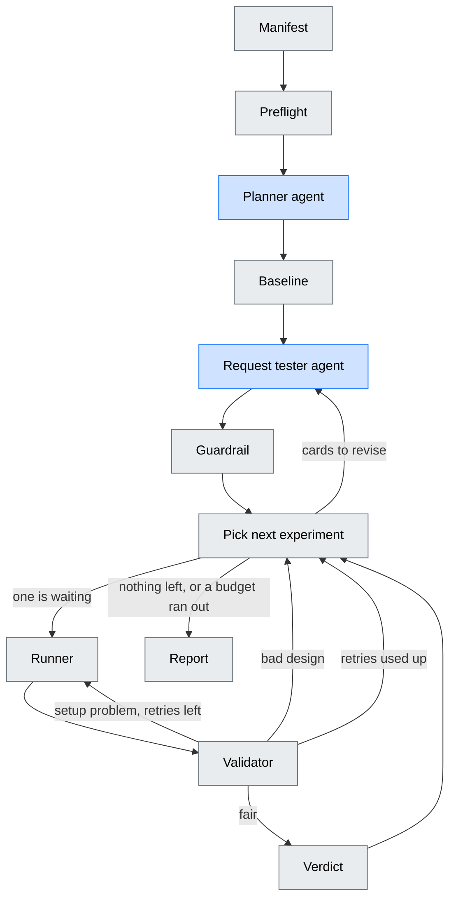
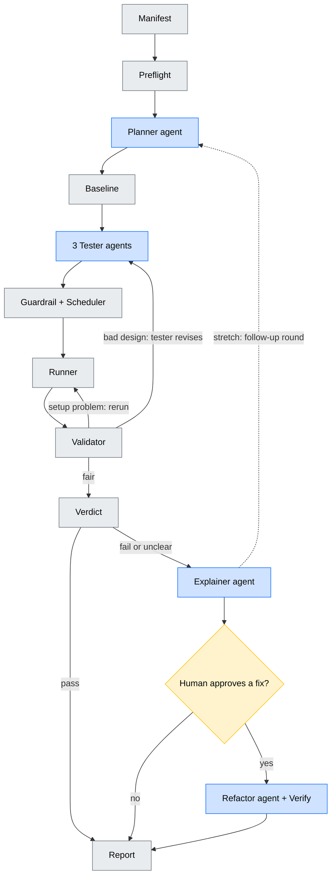

# chaos-swarm

A **multi-agent system** that tries to break a web backend on purpose, inside a throwaway sandbox, then explains what broke and proposes a human-approved fix.

> **Agents propose, code disposes: a test only counts if it was fair.**

| | Agents (LLM) | Plain code |
|---|---|---|
| Do | read code, decide what to test, explain results, write fixes | send traffic, cause failures, measure, apply the rules, decide pass/fail |

An agent never measures and never grades its own work. Nodes share one state and are wired as a graph (LangGraph) with retry loops, human approval gates, and hard budgets so it always stops.

---
## v1 graph (built)

The smallest version that is still a real multi-agent system with LLMs: two agents, one experiment type (a burst of requests), no refactoring. Every experiment ends in **pass**, **fail**, **inconclusive** or **could not test**. The graph is `swarm/graph.py` (LangGraph) over the shared state in `swarm/state.py`; any early failure goes straight to the report.

A design flaw is recorded as feedback and `Pick` sends it back to the tester (up to `max_attempts - 1` revisions per card). Confirmation runs for a clear fail (one repeat) or a borderline result (median of three) happen inside the Verdict node.

| Node | v1 scope | Status |
|---|---|---|
| Manifest | The rulebook for the login backend: limits, rules, login details, budgets, model settings, code location | **built, tested** |
| Preflight | Start the sandbox, prove it has no internet, seed data, check login, save a clean copy | **built, ran on real Docker** |
| Planner | An agent that explores the code with read-only tools, calls the API and database fact tools itself, and writes one brief. Claims without a verifiable quote are dropped | **ran live** (Gemini 3.5 Flash-Lite, about 10 calls) |
| Baseline | Runs at `normal_rps` (what the manifest calls usual traffic) several times for the normal speed and its wobble, then ramps up from there (x3 by default) to find where the backend starts to struggle (its capacity). If even usual traffic is unhealthy, that is reported as a finding. The tester asks for load as a multiple of capacity | **ran live** (about 5 minutes) |
| Request tester | One structured model call (with repairs) that turns the brief and measured capacity into a few experiment cards. Load is a multiple of capacity; it accepts Validator feedback to revise a card | **ran live** (1 call) |
| Guardrail | Turns each card into exact numbers: clamps load and duration to the manifest limits (and records it), rejects unrunnable cards, enforces the experiment budget, double-checks the target host | **ran live** |
| Runner | Reset, one smoke request, then k6 (a one-off container on the sandbox network) sends the load; reads k6's summary and adds machine peaks | **ran live** against real k6 |
| Validator | Fair test? Technical flaw (our machine saturated, no numbers) means rerun the same card; design flaw (a pile of refused requests) means send it back to the tester | **ran live**, but only the "fair" branch; retry and redesign are unit-tested only |
| Verdict | Pass / fail / inconclusive against the baseline and its usual range. A pass needs the card's expected signals to have appeared (else a weak pass, reported as inconclusive). p95 is judged up to measured capacity; above it the error rate and early abort decide | **ran live**; borderline (median of three) path unit-tested only |
| Report | Per experiment: pass / fail / inconclusive / could not test, with numbers, plus an overall label (clean, incomplete, findings, not run) and what was **not** covered. Markdown and JSON | **ran live** |

Out of v1: scheduler, explainer, human gates, database and failure testers, refactor, follow-up rounds.

### Where v1 stands

It runs end to end (about 8 minutes with the trimmed baseline) and the two findings from the first full run are leads, not verdicts. Known gaps, in the order to fix them:

1. **Capacity is measured on one endpoint** and shared by every experiment, so "5x capacity" is not meaningful for an endpoint that costs far more than the baseline one. Plan: measure capacity per tested endpoint, after the tester picks it.
2. **The p95 rule can undercount fast endpoints** (5 ms to 35 ms counts as 7x slower). Needs an absolute floor.
3. **One extreme load per experiment** shows that something collapses, not where it starts to degrade.
4. **Thin coverage:** the tester wrote 2 cards for 11 endpoints.
5. **The report leaves out the sampled signals** (API CPU, database CPU, connections) that support each finding.
6. **Safety nets not yet seen live:** design-flaw redesign, technical retry, median of three, baseline `retry`, `cannot_sustain`, budget truncation. Plan: provoke each with a deliberately awkward setup (for example wrong credentials, a tiny CPU limit, a short wall clock).

## Goal graph (later)

Blue = agent, yellow = human, grey = plain code.

### Nodes

| Node | Role |
|---|---|
| Manifest | The rulebook: how to run the target, how to log in, how hard we may push |
| Preflight | Start the sandbox, fill it with realistic data, check it works |
| Planner | Reads the project, gives each tester a short brief |
| Baseline | Measures normal behaviour, so "slow" means slower than normal |
| Testers (request / database / failure) | Turn a brief into experiment cards (JSON) |
| Guardrail + Scheduler | Reject or shrink cards outside the limits; merge, dedupe, order |
| Runner | Reset, send traffic or cause the failure, record measurements |
| Validator | "Was that a fair test?" |
| Verdict | "Did the backend pass?" |
| Explainer | Explains a failure from a compact evidence summary |
| Refactor + Verify | Proposes a fix on a copy, re-runs the failed experiments to prove it |
| Report | What was tried, what broke, what was **not** covered |

### Edges that matter

| Edge | Meaning |
|---|---|
| Validator → Runner | The setup failed (crash, overloaded machine): rerun the same card |
| Validator → Testers | The card was flawed (wrong login, too little load): send back with the reason |
| Verdict → Explainer | Only failures and unclear results get explained |
| Human gate → Refactor | Only approved problems get a fix |
| Follow-up → Planner | *(stretch)* unclear results trigger a second, different round |

### Inside the boxes (the mechanisms)

- **Validator:** separates a *bad test* from a *failed backend*. A pile of login errors is a bad test, not a fast backend. Out of retries means "could not test", never "pass".
- **Verdict:** compares to the baseline and its normal wobble; a "pass" only counts if the card's *mechanism signal* appeared (proof the load really reached the limit); failures are re-run to confirm.
- **Guardrail:** limits come from the manifest and are enforced in code, never by prompt.
- **Runner / Preflight:** sandbox on an isolated network, reset to a clean copy before every experiment.
- **Verify:** a fix must pass the original experiment, a harder variant, and the app's own tests.

---

## Folders

| Folder | What |
|---|---|
| `swarm/` | The product: `graph.py` and `state.py` (the wiring), plus one module per node (manifest, preflight, planner, calibration for the baseline, tester, guardrail, runner, validator, verdict, report). `swarm/k6/script.js` is the one fixed load script every run uses. `swarm/tools/` holds what the planner uses: the jailed code reader, the API summary and the database schema reader. `harness.py` is an older stand-in for the graph's retry routing, kept for `run_experiments.py` |
| `adapters/` | Glue to the outside world: the Docker sandbox wrapper, the database seeder, machine metrics, and the Gemini client |
| `manifests/` | One rulebook per target |
| `fixtures/` | `deployment_audit/` is the sandbox definition (compose files, Dockerfile, debug forwarder). Practice backends with planted bugs are not built yet |
| `scripts/` | `run_graph.py` runs everything; the others run one piece on its own (see below) |
| `evals/` | Scoreboard for the agents against fixtures. Empty |
| `runs/` | Output of each run: briefs, measurements, audit log, report. Git-ignored |
| `tests/` | 250 unit tests, using scripted fakes for the model, Docker and k6. `tests/data/` holds a real API description and database schema from the target |

## Prerequisites

Python 3.12, Git, WSL2 and Docker Desktop (installed; runs the sandbox). A Gemini API key (free tier) or an Anthropic key, for the two agents. k6 and Postgres run as Docker images, so nothing else to install.

## Build order

| Step | What | Status |
|---|---|---|
| Manifest, sandbox, preflight | The environment | **done** |
| Baseline | Summary and capacity, measured with the runner | **done**, ran live |
| Planner agent | Explores the target, writes the brief | **done**, ran live |
| Request tester | Turns a brief into experiment cards | **done**, ran live |
| Guardrail, Runner | Resolve cards into exact experiments; send the load | **done**, ran live |
| Validator, Verdict, Report | The remaining deterministic nodes | **done**, ran live (clean path) |
| Graph and state | Wiring the nodes together | **done**, ran end to end |
| Next | The gaps listed under "Where v1 stands" | |
| Later | Scheduler, explainer, database and failure testers, refactor, follow-up rounds, fixtures and evals | |

## Manual sandbox testing

Run from the project root with the venv active. Docker Desktop must be running.

The sandbox has no internet and publishes no ports, so you reach it from the inside.

**Launch** (builds, migrates, seeds 50,000 users, takes a clean copy). Success looks like `ok=True` with `isolated`, `login` and `users: 50000`:

    .venv\Scripts\python -c "from swarm.manifest import load_manifest; from swarm.preflight import make_sandbox, run_preflight; m=load_manifest('manifests/deployment_audit.yaml'); print(run_preflight(m, make_sandbox(m)))"

**Look at the database** (`psql` inside the db container):

    docker exec -it chaos_target-db-1 psql -U sandbox -d app

    SELECT count(*) FROM users;                              -- 50000
    SELECT email, role FROM users ORDER BY created_at LIMIT 5;
    \d users                                                 -- columns and indexes
    \q

One-off query without a shell:

    docker exec chaos_target-db-1 psql -U sandbox -d app -tA -c "SELECT role, count(*) FROM users GROUP BY role"

**Send a request** (made from inside the sandbox, returns `(status, body)`):

    .venv\Scripts\python -c "from swarm.manifest import load_manifest; from swarm.preflight import make_sandbox; s=make_sandbox(load_manifest('manifests/deployment_audit.yaml')); print(s.request('POST','http://api:8000/api/login', form={'username':'user0@example.com','password':'sandbox-pass-0'}))"

**Swagger in the browser** (debug only). The forwarder in `docker-compose.debug.yml` is the only container with internet access; the API stays isolated. Start it:

    docker compose -p chaos_target -f fixtures/deployment_audit/docker-compose.yml -f fixtures/deployment_audit/docker-compose.debug.yml up -d proxy

Open <http://127.0.0.1:8000/docs> and use **Authorize**: `user0@example.com` / `sandbox-pass-0`, or `admin0@example.com` / `sandbox-pass-admin` for admin routes. Remove the forwarder when done, and always before a real run:

    docker compose -p chaos_target -f fixtures/deployment_audit/docker-compose.yml -f fixtures/deployment_audit/docker-compose.debug.yml rm -sf proxy

**Reset to the clean copy** (back to 50,000 users in seconds):

    .venv\Scripts\python -c "from swarm.manifest import load_manifest; from swarm.preflight import make_sandbox; make_sandbox(load_manifest('manifests/deployment_audit.yaml')).reset('http://api:8000/health')"

**Tear down** (deletes the containers and data):

    .venv\Scripts\python -c "from swarm.manifest import load_manifest; from swarm.preflight import make_sandbox; make_sandbox(load_manifest('manifests/deployment_audit.yaml')).down()"

## A real run

**One-time setup:** paste a key into `.env` (`GEMINI_API_KEY` for the default provider, from <https://aistudio.google.com/apikey>). The provider, model names and request pacing live in the manifest's `llm` section. Check the model IDs and limits in the manifest against Google AI Studio.

**The whole graph, one command** (Docker Desktop running; about 8 to 20 minutes depending on the backend; writes everything to `runs/graph_<time>/`):

    .venv\Scripts\python scripts/run_graph.py

Preflight is safe to repeat: it empties the users table, reseeds and replaces the clean copy. For a fully fresh start (a run was killed midway, or you changed the compose file or Dockerfile), run `docker compose -f fixtures/deployment_audit/docker-compose.yml down -v` first.

**Piece by piece.** Each script runs one part of the pipeline for real and saves its output under `runs/`, so the next script picks up the newest result.

| Step | Command | What it does | LLM calls |
|---|---|---|---|
| 1 | Launch the sandbox (see "Manual sandbox testing") | Start the stack, seed it, save the clean copy | 0 |
| 2 | `python scripts/run_planner.py` | Planner explores the code and API, writes `brief.json` | up to 12 |
| 3 | `python scripts/run_baseline.py` | Measures normal speed at `normal_rps`, then ramps up to find capacity (about 4 to 8 minutes with the trimmed settings) | 0 |
| 4 | `python scripts/run_tester.py` | Tester designs cards from the brief and the measured capacity; the Guardrail resolves them | up to 2 |
| 5 | `python scripts/run_experiments.py` | Runs every experiment, validates, judges, writes `report.md` and `report.json` | 0 |

Run them with the venv's Python (`.venv\Scripts\python` on Windows). Quick checks: `run_planner.py --offline` (planner with saved facts, no Docker), `run_tester.py --capacity-rps 120` (tester with a stand-in capacity), `run_load.py` (one load plan by hand).

On Gemini: the planner and tester are written against an Anthropic-shaped client, and `adapters/gemini.py` translates. The manifest's `llm.limits` table holds your free-tier allowance per model (copy it from Google AI Studio's rate-limit page). Calls are paced to each model's per-minute limit and counted against its daily limit in `runs/llm_usage.json`; the tool refuses to call a model whose day is used up. Every attempt counts, retries included, so retries are capped at 2. Defaults are the two Flash-Lite models (500 calls a day each); the full Flash models allow only 20 a day, so keep them for quality comparisons.

## Dev

    python -m venv .venv
    .venv\Scripts\pip install -e .[dev]
    .venv\Scripts\python -m pytest
