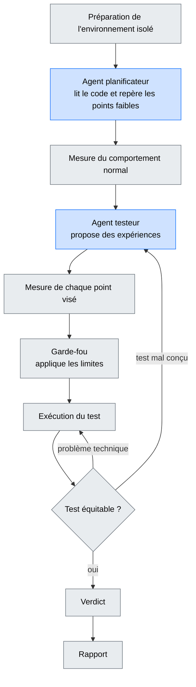

# chaos-swarm

Un **système multi-agents** qui met un serveur web à l'épreuve, tout seul : il lit son code, devine où il risque de lâcher, le pousse sous une forte charge dans un environnement isolé, puis rédige un rapport.

> **Les agents proposent, le code décide.** Un test ne compte que s'il était équitable.

---

## L'idée

Tester la résistance d'un serveur demande d'habitude un expert : comprendre le code, choisir quoi attaquer, lancer les tests, interpréter les chiffres. Ce projet confie la partie « réflexion » à des agents IA et garde tout ce qui doit être fiable dans du code classique.

| | Agents IA | Code classique |
|---|---|---|
| Rôle | lire le code, émettre des hypothèses, proposer des tests | envoyer le trafic, mesurer, appliquer les règles, juger |

Un agent ne mesure jamais rien et ne note jamais son propre travail.

## Comment ça marche



1. **Préparation.** Le serveur à tester tourne dans des conteneurs Docker coupés d'Internet, remplis avec 50 000 utilisateurs fictifs.
2. **Planificateur (IA).** Il explore le code avec des outils en lecture seule et rédige une fiche : les points d'accès du serveur, ceux à ne pas toucher (suppression de comptes…) et les risques. Chaque affirmation doit citer une ligne exacte du code, vérifiée automatiquement ; sinon elle est écartée.
3. **Comportement normal.** On mesure la vitesse du serveur sous un trafic habituel, pour savoir ce que « lent » veut dire.
4. **Testeur (IA).** À partir des risques, il propose quelques expériences : « envoyer 2 fois plus de connexions que ce que le serveur supporte, pendant une minute ».
5. **Mesure de chaque point visé.** Chaque point d'accès choisi est mesuré séparément. Ainsi, « 2 fois sa capacité » a le même sens pour une page rapide que pour une connexion coûteuse, sans rien supposer à l'avance.
6. **Garde-fou.** Les limites (charge maximale, durée) viennent d'un fichier de règles et sont imposées par le code, jamais par une consigne donnée à l'IA.
7. **Exécution et contrôle.** Le trafic est envoyé avec k6. Le système vérifie ensuite que le test était équitable : si l'ordinateur lui-même saturait, on recommence ; si la plupart des requêtes étaient refusées (mauvais identifiants…), l'expérience repart au testeur avec la raison.
8. **Verdict et rapport.** Réussi, échoué, non concluant ou impossible à tester, avec les chiffres, et surtout **ce qui n'a pas été couvert**.

## Premier essai complet

Sur un serveur FastAPI + PostgreSQL inconnu du système, en 8 minutes environ :

- le planificateur a repéré seul deux risques : la vérification des mots de passe, très gourmande en calcul, et une liste d'utilisateurs triée sans index ;
- les deux tests ont confirmé un effondrement sous forte charge, et les mesures pointaient bien vers les causes prévues (processeur du serveur à 99 % pour la connexion, base de données à 84 % pour la liste) ;
- les actions destructrices (suppression ou modification de comptes) ont été exclues d'office.

Ce premier essai a aussi montré deux faiblesses de mesure, corrigées depuis : la charge était calculée à partir d'un seul point d'accès pour tous les tests, et un point très rapide (5 ms → 35 ms) pouvait être jugé « lent » à tort.

## Ce qui rend le projet solide

- **Preuves vérifiées :** l'IA doit citer le code mot pour mot ; une citation introuvable est rejetée.
- **Limites imposées par le code :** aucune consigne à l'IA ne peut dépasser les règles.
- **Environnement jetable et isolé :** pas d'accès à Internet, base remise à zéro avant chaque test.
- **Budgets partout :** nombre d'appels à l'IA, durée totale, nombre d'expériences ; le système s'arrête toujours.
- **Tests automatisés :** 260 tests vérifient chaque étape sans Docker ni IA.
- **IA gratuite :** fonctionne avec l'offre gratuite de Google Gemini, en respectant ses quotas.

## Où en est le projet

| | |
|---|---|
| **Fait** | toute la chaîne, de la préparation au rapport, orchestrée avec LangGraph |
| **À valider** | la mesure par point d'accès, pas encore lancée en conditions réelles |
| **Ensuite** | des serveurs d'entraînement avec des défauts cachés, pour mesurer combien le système en trouve, et comparer avec une version sans IA |
| **Plus tard** | un agent qui explique les échecs et propose une correction, validée par un humain |

## Technologies

Python, LangGraph, Google Gemini, Docker, PostgreSQL, k6, Pydantic, pytest.

## Lancer le projet

Prérequis : Python 3.12, Docker Desktop, une clé Gemini gratuite (<https://aistudio.google.com/apikey>) à placer dans un fichier `.env` (voir `.env.example`).

```bash
python -m venv .venv
.venv\Scripts\pip install -e .[dev]
.venv\Scripts\python scripts/run_graph.py
```

Le rapport est écrit dans `runs/`. Les règles du test (limites, budgets, modèle d'IA) sont dans `manifests/deployment_audit.yaml`.
