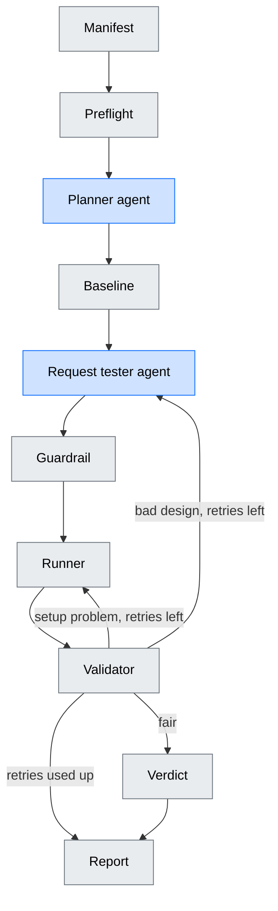
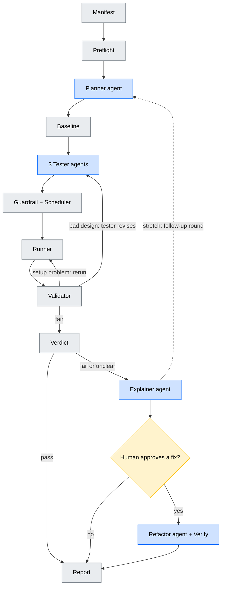

# chaos-swarm

A **multi-agent system** that tries to break a web backend on purpose, inside a throwaway sandbox, then explains what broke and proposes a human-approved fix.

> **Agents propose, code disposes: a test only counts if it was fair.**

| | Agents (LLM) | Plain code |
|---|---|---|
| Do | read code, decide what to test, explain results, write fixes | send traffic, cause failures, measure, apply the rules, decide pass/fail |

An agent never measures and never grades its own work. Nodes share one state and are wired as a graph (LangGraph) with retry loops, human approval gates, and hard budgets so it always stops.

---
## v1 graph (target)

The smallest version that is still a real multi-agent system with LLMs: two agents, one experiment type (a burst of requests), no refactoring. Every run ends in **pass**, **fail**, or **could not test**.

| Node | v1 scope | Status |
|---|---|---|
| Manifest | The rulebook for the login backend: limits, rules, login details, budgets, model settings, code location | **built, tested** |
| Preflight | Start the sandbox, prove it has no internet, seed data, check login, save a clean copy | **built, ran on real Docker** |
| Planner | An agent that explores the code with read-only tools, calls the API and database fact tools itself, and writes one brief. Claims without a verifiable quote are dropped | **built, tested with a fake model; not yet run on a real one** |
| Baseline | Runs at `normal_rps` (what the manifest calls usual traffic) several times for the normal speed and its wobble, then ramps up from there (doubling by default) to find where the backend starts to struggle (its capacity). If even usual traffic is unhealthy, that is reported as a finding. The tester asks for load as a multiple of capacity | maths and the capacity-usability check built; needs the runner to measure |
| Request tester | One structured model call (with repairs) that turns the brief and measured capacity into a few experiment cards. Load is a multiple of capacity; it accepts Validator feedback to revise a card | **built, tested with a fake model; not yet run on a real one** |
| Guardrail | Turns each card into exact numbers: clamps load and duration to the manifest limits (and records it), rejects unrunnable cards, enforces the experiment budget, double-checks the target host | **built, tested** |
| Runner | Reset, one smoke request, then k6 (a one-off container on the sandbox network) sends the load; reads k6's summary and adds machine peaks | **built, tested against fakes; not yet run against real k6** |
| Validator | Fair test? Says whether a retry should rerun or redesign | to build |
| Verdict | Pass or fail against baseline | to build |
| Report | Per experiment: pass / fail / could not test, with numbers | to build |

Out of v1: scheduler, explainer, human gates, database and failure testers, refactor, follow-up rounds.

## Goal graph (later)

Blue = agent, yellow = human, grey = plain code.

### Nodes

| Node | Role |
|---|---|
| Manifest | The rulebook: how to run the target, how to log in, how hard we may push |
| Preflight | Start the sandbox, fill it with realistic data, check it works |
| Planner | Reads the project, gives each tester a short brief |
| Baseline | Measures normal behaviour, so "slow" means slower than normal |
| Testers (request / database / failure) | Turn a brief into experiment cards (JSON) |
| Guardrail + Scheduler | Reject or shrink cards outside the limits; merge, dedupe, order |
| Runner | Reset, send traffic or cause the failure, record measurements |
| Validator | "Was that a fair test?" |
| Verdict | "Did the backend pass?" |
| Explainer | Explains a failure from a compact evidence summary |
| Refactor + Verify | Proposes a fix on a copy, re-runs the failed experiments to prove it |
| Report | What was tried, what broke, what was **not** covered |

### Edges that matter

| Edge | Meaning |
|---|---|
| Validator → Runner | The setup failed (crash, overloaded machine): rerun the same card |
| Validator → Testers | The card was flawed (wrong login, too little load): send back with the reason |
| Verdict → Explainer | Only failures and unclear results get explained |
| Human gate → Refactor | Only approved problems get a fix |
| Follow-up → Planner | *(stretch)* unclear results trigger a second, different round |

### Inside the boxes (the mechanisms)

- **Validator:** separates a *bad test* from a *failed backend*. A pile of login errors is a bad test, not a fast backend. Out of retries means "could not test", never "pass".
- **Verdict:** compares to the baseline and its normal wobble; a "pass" only counts if the card's *mechanism signal* appeared (proof the load really reached the limit); failures are re-run to confirm.
- **Guardrail:** limits come from the manifest and are enforced in code, never by prompt.
- **Runner / Preflight:** sandbox on an isolated network, reset to a clean copy before every experiment.
- **Verify:** a fix must pass the original experiment, a harder variant, and the app's own tests.

---

## Folders

| Folder | What |
|---|---|
| `swarm/` | The product. So far: manifest, preflight, baseline maths, the planner and its checks. `swarm/k6/script.js` is the one fixed load script every run uses. `swarm/tools/` holds what the planner uses: the jailed code reader, the API summary and the database schema reader |
| `adapters/` | Glue to the outside world: the Docker sandbox wrapper and the database seeder |
| `manifests/` | One rulebook per target |
| `fixtures/` | `deployment_audit/` is the sandbox definition (compose files, Dockerfile, debug forwarder). Practice backends with planted bugs are not built yet |
| `scripts/` | Run a piece on its own: `run_planner.py`, `run_load.py` (one load plan against the live sandbox) |
| `evals/` | Scoreboard for the agents against fixtures. Empty |
| `runs/` | Output of each run: briefs, measurements, audit log. Git-ignored |
| `tests/` | 129 unit tests. `tests/data/` holds a real API description and database schema from the target |

## Prerequisites

Python 3.12, Git, WSL2 and Docker Desktop (installed; runs the sandbox). An Anthropic API key is needed to run the planner. k6 and Postgres run as Docker images, so nothing else to install.

## Build order

| Step | What | Status |
|---|---|---|
| Manifest, sandbox, preflight | The environment | **done** |
| Baseline maths | Summary and capacity from measurements | **done** (needs the runner to feed it) |
| Planner agent | Explores the target, writes the brief | **done**, awaiting its first real-model run |
| Request tester | Turns a brief into experiment cards | **done**, awaiting its first real-model run |
| Guardrail, Runner | Resolve cards into exact experiments; send the load | **done**; Runner awaiting its first real k6 run |
| Validator, Verdict, Report | The remaining deterministic nodes | next: Validator |
| Graph and state | Wiring the nodes together | you |
| Later | Scheduler, explainer, database and failure testers, refactor, follow-up rounds, fixtures and evals | |

## Manual sandbox testing

Run from the project root with the venv active. Docker Desktop must be running.

The sandbox has no internet and publishes no ports, so you reach it from the inside.

**Launch** (builds, migrates, seeds 50,000 users, takes a clean copy). Success looks like `ok=True` with `isolated`, `login` and `users: 50000`:

    .venv\Scripts\python -c "from swarm.manifest import load_manifest; from swarm.preflight import make_sandbox, run_preflight; m=load_manifest('manifests/deployment_audit.yaml'); print(run_preflight(m, make_sandbox(m)))"

**Look at the database** (`psql` inside the db container):

    docker exec -it chaos_target-db-1 psql -U sandbox -d app

    SELECT count(*) FROM users;                              -- 50000
    SELECT email, role FROM users ORDER BY created_at LIMIT 5;
    \d users                                                 -- columns and indexes
    \q

One-off query without a shell:

    docker exec chaos_target-db-1 psql -U sandbox -d app -tA -c "SELECT role, count(*) FROM users GROUP BY role"

**Send a request** (made from inside the sandbox, returns `(status, body)`):

    .venv\Scripts\python -c "from swarm.manifest import load_manifest; from swarm.preflight import make_sandbox; s=make_sandbox(load_manifest('manifests/deployment_audit.yaml')); print(s.request('POST','http://api:8000/api/login', form={'username':'user0@example.com','password':'sandbox-pass-0'}))"

**Swagger in the browser** (debug only). The forwarder in `docker-compose.debug.yml` is the only container with internet access; the API stays isolated. Start it:

    docker compose -p chaos_target -f fixtures/deployment_audit/docker-compose.yml -f fixtures/deployment_audit/docker-compose.debug.yml up -d proxy

Open <http://127.0.0.1:8000/docs> and use **Authorize**: `user0@example.com` / `sandbox-pass-0`, or `admin0@example.com` / `sandbox-pass-admin` for admin routes. Remove the forwarder when done, and always before a real run:

    docker compose -p chaos_target -f fixtures/deployment_audit/docker-compose.yml -f fixtures/deployment_audit/docker-compose.debug.yml rm -sf proxy

**Reset to the clean copy** (back to 50,000 users in seconds):

    .venv\Scripts\python -c "from swarm.manifest import load_manifest; from swarm.preflight import make_sandbox; make_sandbox(load_manifest('manifests/deployment_audit.yaml')).reset('http://api:8000/health')"

**Tear down** (deletes the containers and data):

    .venv\Scripts\python -c "from swarm.manifest import load_manifest; from swarm.preflight import make_sandbox; make_sandbox(load_manifest('manifests/deployment_audit.yaml')).down()"

## Run the planner on its own

Needs an API key in the environment (`$env:ANTHROPIC_API_KEY = "..."` in PowerShell). Output goes to `runs/planner_<time>/` as `brief.json` plus `audit.jsonl` (every denied read, dropped claim and budget event).

Offline, using saved facts (no Docker):

    .venv\Scripts\python scripts\run_planner.py --offline

Against the live sandbox (launch it first):

    .venv\Scripts\python scripts\run_planner.py

The model, effort and step budget live in the manifest's `llm` section.

## Dev

    python -m venv .venv
    .venv\Scripts\pip install -e .[dev]
    .venv\Scripts\python -m pytest
